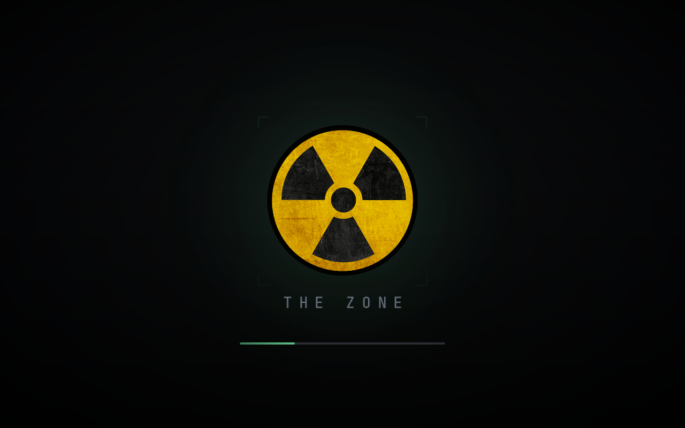
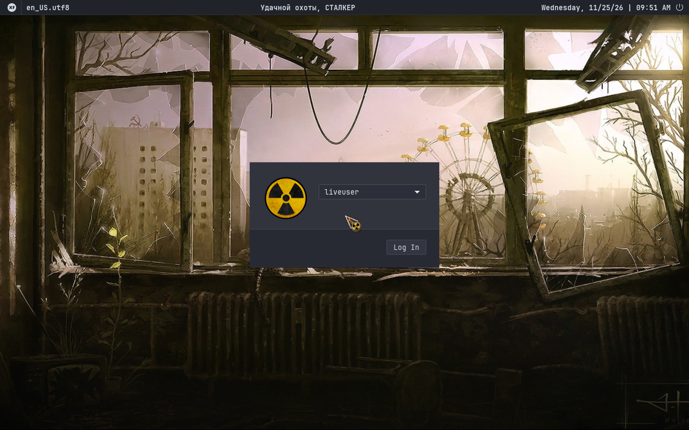
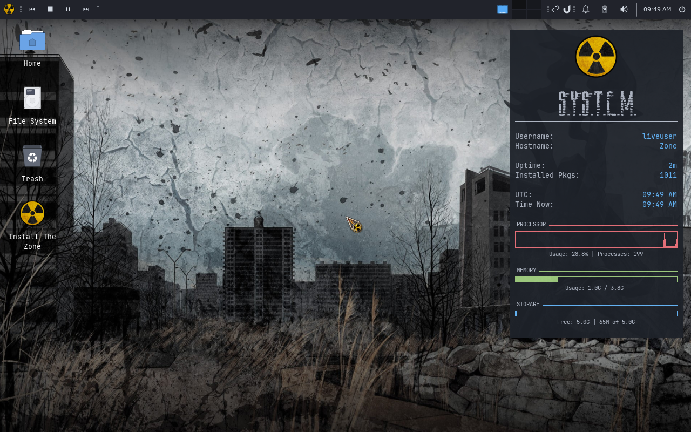
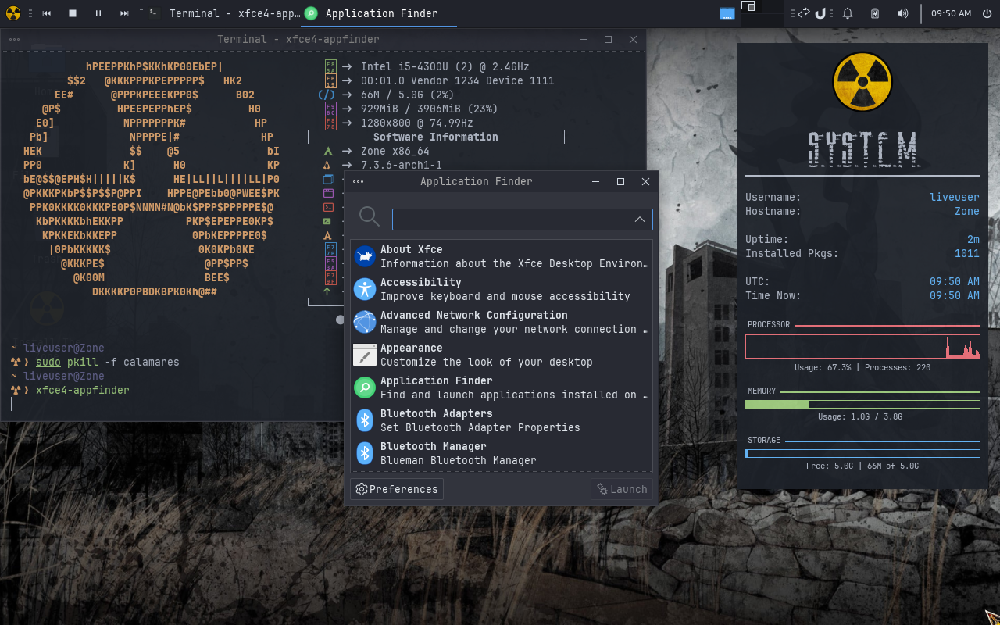
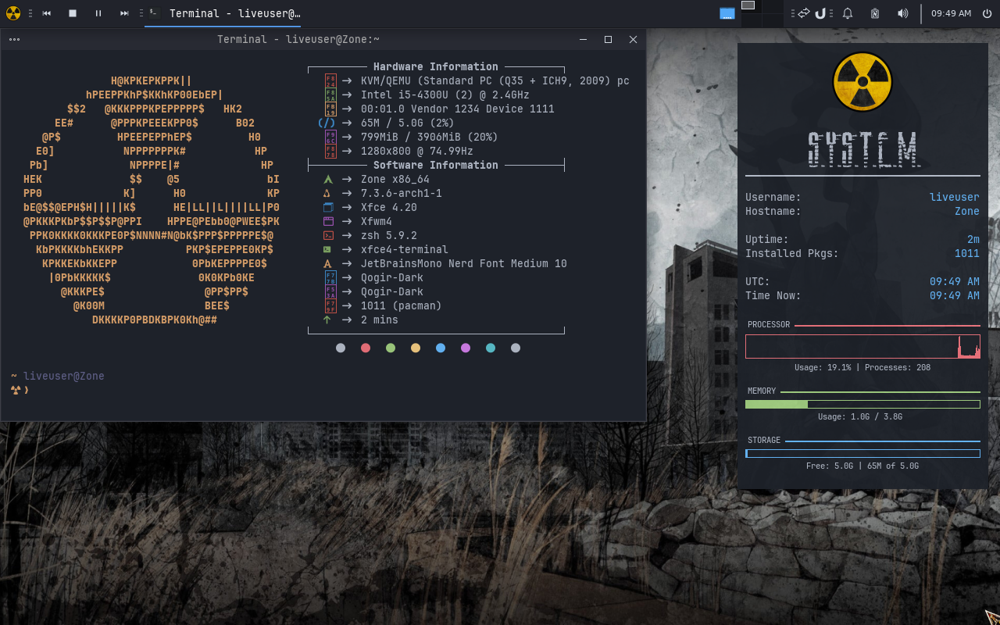
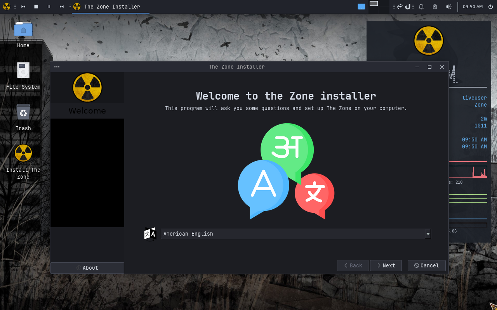

<p align="center">

</p>
<h1 align="center">Welcome To The Zone</h1>

Zone Linux is a custom Arch Linux-based live ISO with an XFCE desktop themed around
S.T.A.L.K.E.R.

## Screenshots

<table>
  <tr>
    <td></td>
    <td></td>
  </tr>
  <tr>
    <td></td>
    <td></td>
  </tr>
  <tr>
    <td></td>
    <td></td>
  </tr>
</table>

The screenshots are captured from a built ISO under QEMU/KVM. Regenerate them with:

```bash
./scripts/capture-screenshots.sh            # newest zone-out/zone-*.iso
./scripts/capture-screenshots.sh path.iso   # a specific ISO
```

## Build (Docker — recommended)

Docker is the supported path on non-root hosts. The script builds the `zone-builder`
image, runs `mkarchiso` inside it, and restores ownership of the output.

```bash
./build.sh                      # use the repositories configured in pacman.conf
./build.sh --local-repos        # use the workspace zone-*-repo checkouts
./build.sh --clean              # remove the work directory first
./build.sh --no-cache           # rebuild the builder image
```

The ISO is written to `zone-out/`, together with a `.sha256` checksum.

## Build (native archiso)

Requires a current Arch Linux host with `archiso` installed and root access:

```bash
sudo ./build.sh --native --local-repos
```

## Flash to USB

```bash
./flash.sh                      # interactive, USB-only device list
sudo dd if=zone-out/zone-*.iso of=/dev/sdX bs=4M status=progress oflag=sync
```

Replace `/dev/sdX` with the target device (check with `lsblk`).

## Test

```bash
./test.sh --bios --verify
./test.sh --uefi --verify
./test.sh --headless --timeout 180
```

## Boot splash

The ISO ships Plymouth with four Zone themes (`zone-mark`, `zone-anomaly`,
`zone-pda`, `zone-sector`) from `zone-plymouth-theme`. All four are embedded in
the initramfs and one is chosen per boot from the kernel random UUID mixed with
the boot time.

- `zone.splash=zone-pda` on the kernel command line forces a theme for that boot.
- `zone-splash-theme <theme>` (installed systems, as root) pins a theme and
  rebuilds the initramfs; `zone-splash-theme random` restores per-boot rotation.
- The bootloader menu is unchanged; only the kernel command line carries
  `splash vt.global_cursor_default=0 plymouth.ignore-serial-consoles`.

The saved boot entry needs `splash` for graphical mode. The live initramfs
enables the `kms` hook so BIOS systems have a framebuffer before the root
filesystem is mounted; UEFI systems can also use the firmware framebuffer.
`plymouth.ignore-serial-consoles` keeps the graphical splash on machines whose
kernel command line also contains a serial console, and headless serial tests
still work because the splash falls back to text mode when no framebuffer is
available.

## CI

`.github/workflows/ci.yml` has three jobs:

- **profile** runs on every push and pull request: bash syntax, shellcheck,
  profile consistency, boot entries and the package list.
- **build** runs on pushes to `master` and manual dispatches: it builds the ISO
  with the same Docker path as `./build.sh`, verifies the checksum and the
  boot-splash payload (boot entries, `zone-splash`, Plymouth and all four
  themes), writes the installed package list to `packages.txt`, then uploads
  the ISO, `.sha256` and `packages.txt` as a 7-day artifact.
- **release** runs after a successful build on pushes to `master` and manual
  dispatches (never on pull requests). It verifies the checksum, tags the build
  `v<version>-r<run_number>`, and publishes a GitHub release whose notes carry
  the commit changelog since the previous release plus the installed package
  list. GitHub caps each release asset at 2 GiB, so the ~3.2 GiB ISO is split
  into `*.part-00`, `*.part-01`, …; the attached `join-zone-iso.sh`
  reassembles and verifies it:

  ```bash
  bash join-zone-iso.sh zone-2026.11.25-x86_64.iso
  ```

Pull requests stop after the profile job: they do not run a privileged
container build, and the 3.2 GB artifact is only useful for real builds.

## Sound

The `Zone` freedesktop sound theme, `zone-detector` and the extended
`startupsound` ship in the `zone-xfce` package: the theme and all 16 OGG
assets land in `/usr/share/sounds/zone`, the scripts in `/usr/bin`, and the
detector unit in `/etc/skel/.config/systemd/user`. `libcanberra` is listed in
`packages.x86_64` explicitly because the GTK module would otherwise only be a
transitive dependency of `xfce4-settings`.

## Adding a Package

1. Add the package name to `archiso/packages.x86_64`.
2. If the package ships executables in `airootfs/usr/local/bin/`, add a `"0:0:755"`
   entry in `profiledef.sh`'s `file_permissions` array.
3. If it is a custom package, build it in `zone-pkgbuild/`, publish it to the
   matching `zone-*-repo`, and make sure `pacman.conf` references that repo.

## Repository Layout

| Path | Purpose |
|---|---|
| `archiso/` | archiso profile (packages, hooks, configs, bootloaders) |
| `archiso/airootfs/` | Files overlaid onto the live rootfs |
| `archiso/packages.x86_64` | All packages installed in the live ISO |
| `archiso/efiboot/` | systemd-boot entries (UEFI) |
| `archiso/syslinux/` | syslinux entries (BIOS) |
| `docker/` | Dockerfile for containerised builds |
| `.github/workflows/ci.yml` | Profile validation, ISO build, package manifest, release |
| `.github/scripts/check-iso.sh` | Asserts boot entries and initramfs carry the splash |
| `.github/scripts/iso-packages.sh` | Writes the installed package list from a built ISO |
| `scripts/capture-screenshots.sh` | Captures the README screenshots under QEMU |
| `scripts/qmp.py` | QMP client used by the screenshot capture |
| `docs/screenshots/` | Screenshots embedded in this README |
| `build.sh` | Docker/native build wrapper |

`zone-live-setup.service` runs `airootfs/usr/local/bin/zone-live-setup` once at
boot. It replaces the deprecated archiso `customize_airootfs.sh` hook.

## Notable Changes (2022 → 2026)

- archiso 92 bootmodes: `bios.syslinux` + `uefi.systemd-boot` (old aliases removed)
- Boot entries use `archisosearchuuid` and a single initramfs (microcode embedded)
- `mkinitcpio.conf.d/archiso.conf` replaces the full `mkinitcpio.conf` override
- No `/etc/mkinitcpio.d/linux.preset` is shipped: mkinitcpio generates presets
  from `hook.preset`, and a custom preset with `ALL_config` would disable the
  `mkinitcpio.conf.d` drop-ins (dropping the `archiso` hook and breaking boot)
- `customize_airootfs.sh` replaced by `zone-live-setup.service`
- `udev/rules.d/98-zone-live-no-gpt-loop.rules` suppresses systemd's unused
  GPT auto-discovery loop attach on optical drives (noisy UEFI-only failure)
- Accessibility/speech boot entry and `memtest86+` EFI entry added
- pacman.conf: defunct `[community]` removed; `CheckSpace` disabled for the chroot
- packages: dead names replaced (`exa`→`eza`, `blueberry`→`blueman`, `ntfs-3g`→`ntfsprogs`,
  `nvidia`→`nvidia-open`, `gnu-netcat`→`openbsd-netcat`); `crda`, `reiserfsprogs`,
  `ueberzug`, `mplayer`, `broadcom-wl`, `ipw2100-fw`, `ipw2200-fw` removed
- Legacy `installation-scripts/` deleted; `build.sh` is the single entry point
